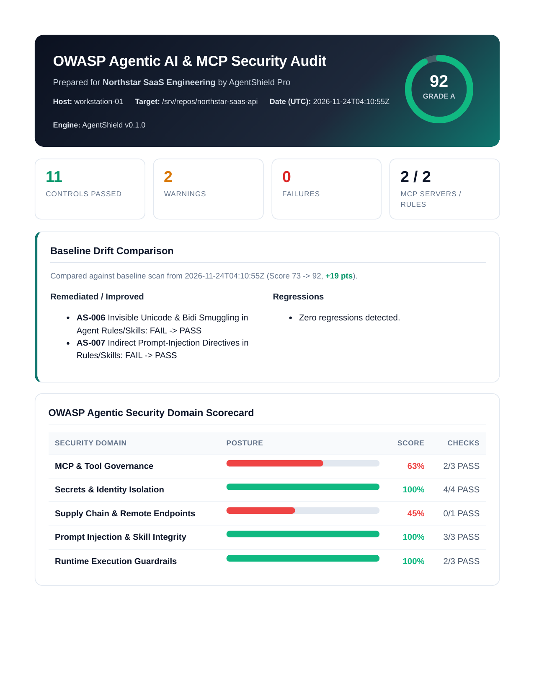

# AgentShield

**Zero-dependency AI coding agent, MCP server, and prompt-injection security auditor mapped to the OWASP Top 10 for Agentic AI.**

Developers and IT teams now run coding agents (Cursor, Claude Desktop, Claude Code, Windsurf, Gemini CLI, Antigravity) with live MCP tools, shell execution, and downloaded `SKILL.md` / `.cursorrules` / `AGENTS.md` files. One poisoned skill file, unpinned `npx` MCP package, or exposed local Ollama/CDP port can leak API keys or trigger silent remote code execution.

**AgentShield** audits any workstation or Git repository in under 1 second using pure Python 3.10+ stdlib (zero third-party dependencies, 100% read-only, secrets always masked).

## 10-Second Quickstart

```bash
git clone https://github.com/rasetsukyo/agentshield.git
cd agentshield

# Scan your current repo + local workstation MCP/agent configs
python3 -m agentshield scan --path .

# CI/CD repo-only scan (exits with code 2 on HIGH or CRITICAL findings)
python3 -m agentshield scan --path . --no-home --redact --fail-on high

# Export Markdown + JSON
python3 -m agentshield scan --path . --redact --format terminal,md,json --out-dir ./audit
```

## What AgentShield Checks (14 OWASP Agentic Controls)

| ID | OWASP Ref | Severity | Control |
| :--- | :--- | :--- | :--- |
| `AS-001` | OWASP ASI02 | INFO | MCP server inventory across Cursor, Claude, Windsurf, Gemini, VS Code, and repo configs |
| `AS-002` | OWASP ASI02 | HIGH | Missing least-privilege guardrails on high-impact MCP tools (email, shell, DB, cloud, filesystem) |
| `AS-003` | OWASP ASI03 | CRITICAL | Hardcoded API keys, OAuth secrets, and plaintext tokens in MCP configs (masked in output) |
| `AS-004` | OWASP ASI03 | MEDIUM | Strict `0600` POSIX permissions on MCP configs and `.env` files |
| `AS-005` | OWASP ASI04 | HIGH | Unpinned `npx`/`uvx` supply-chain runners, `:latest` Docker tags, and unencrypted HTTP MCP URLs |
| `AS-006` | OWASP ASI01 | CRITICAL | Invisible Unicode Tag (`U+E0000-E007F`), zero-width, and Trojan Source Bidi smuggling in rules/skills |
| `AS-007` | OWASP ASI01 | HIGH | Indirect prompt-injection override and stealth directives in `AGENTS.md`, `SKILL.md`, `.cursorrules` |
| `AS-008` | OWASP ASI05 | CRITICAL | Remote shell RCE (`curl \| sh`, base64-to-shell) and webhook exfiltration sinks in skills/configs |
| `AS-009` | OWASP ASI05 | HIGH | Dangerous auto-approve / YOLO execution flags (`yoloMode`, `dangerously-skip-permissions`, `Bash(*)`) |
| `AS-010` | OWASP ASI07 | CRITICAL | Local LLM, agent, and Chrome CDP debug ports (`11434`, `8080`, `8000`, `9222`) bound to `0.0.0.0` |
| `AS-011` | OWASP ASI03 | CRITICAL | Tracked `.env` files and hardcoded AI/cloud secrets inside repositories |
| `AS-012` | OWASP ASI04 | HIGH | Untrusted workspace-level auto-executing agent hooks (`.claude/settings.json`, `.cursor/hooks`) |
| `AS-013` | OWASP ASI06 | HIGH | Private SSH keys, PEM certificates, and cloud credentials exposed inside coding workspaces |
| `AS-014` | OWASP ASI08 | LOW | Agent ignore rules (`.aiignore` / `.cursorignore` / `.geminiignore`) and policy baselines |

## Need Executive PDF/DOCX Reports, Drift Tracking & Hardened MCP Templates?

The core scanner in this repository is free and MIT-licensed forever.

If you audit client repos, run security governance for an engineering org, or want drop-in hardened configs, grab **[AgentShield Pro ($39 one-time, zero subscriptions)](https://rasetsukyo.gumroad.com/l/agentshield)**:
- **White-Label OWASP Agentic AI Executive PDF & Editable Word (.docx) Reports** (`--org`, `--auditor`, `--logo`, `--accent "#HEX"`)
- **Remediation Drift Comparison (`--diff baseline.json`)** proving score gains and zero regressions across sprints
- **Hardened Template Pack:** Least-privilege Google Workspace MCP override config, pinned read-only Filesystem MCP config, starter `.aiignore`, and drop-in GitHub Actions PR gate
- **Perpetual Commercial License** for unlimited internal and client deliverables



## Safety Guarantee
AgentShield is strictly read-only. It never modifies files, never phones home, and always masks detected secret literals before printing or exporting reports.
